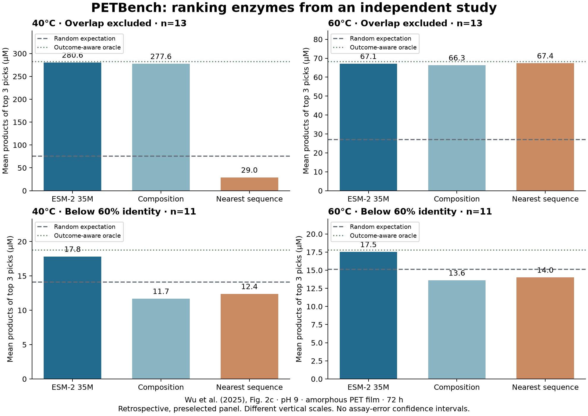

# PETBench: can a ranking transfer between labs?

**A useful, limited positive result:** a fixed model trained on one study selects
productive enzymes in a second published study, but simple baselines remain
competitive and close relatives explain much of the large headline gain.

At 40°C, the AI-selected trio averages **280.57 µM** of PET breakdown products,
versus **75.31 µM** for random selection and **29.03 µM** for nearest-sequence
selection. Composition reaches **277.56 µM**, almost the same as AI. At 60°C,
nearest-sequence selection slightly beats AI on top-three activity (**67.37 vs
67.11 µM**). Higher overall rank correlation does not automatically mean a better
top-three batch.

## What survives the harder test?

One overlapping construct (APET-15 / DP093) was excluded before evaluation,
leaving 13 candidates. Removing APET-14 and APET-17, which have close training
relatives, leaves 11 candidates below 60% global identity.

On that distant subset, AI's selected mean is **17.82 vs 14.12 µM random** at 40°C
and **17.53 vs 15.14 µM random** at 60°C. AI beats both simple baselines in this
subset, but the absolute differences are small. Its rank correlations are **0.28**
and **0.72**, respectively. This suggests transferable ranking information in
this panel; it does not establish that the small gains exceed assay variability.

## Complete comparison

All activity values below are measured external TPA + MHET concentrations after
72 hours, averaged over three selected proteins. They are not model-calibrated
predictions or estimates of industrial recycling yield.

| Assay | Cohort | Method | Spearman | Selected mean µM | Random mean µM | Selected IDs |
|---|---|---|---:|---:|---:|---|
| 40°C | 13 eligible | ESM-2 35M | 0.56 | 280.57 | 75.31 | APET-17, APET-14, APET-5 |
| 40°C | 11 below 60% | ESM-2 35M | 0.28 | 17.82 | 14.12 | APET-5, APET-24, APET-19 |
| 40°C | 13 eligible | Composition | 0.27 | 277.56 | 75.31 | APET-17, APET-14, APET-27 |
| 40°C | 11 below 60% | Composition | -0.20 | 11.68 | 14.12 | APET-27, APET-24, APET-26 |
| 40°C | 13 eligible | Nearest sequence | 0.15 | 29.03 | 75.31 | APET-17, APET-26, APET-27 |
| 40°C | 11 below 60% | Nearest sequence | -0.25 | 12.39 | 14.12 | APET-26, APET-27, APET-25 |
| 60°C | 13 eligible | ESM-2 35M | 0.80 | 67.11 | 27.03 | APET-17, APET-14, APET-5 |
| 60°C | 11 below 60% | ESM-2 35M | 0.72 | 17.53 | 15.14 | APET-5, APET-24, APET-19 |
| 60°C | 13 eligible | Composition | 0.35 | 66.32 | 27.03 | APET-14, APET-17, APET-26 |
| 60°C | 11 below 60% | Composition | -0.02 | 13.60 | 15.14 | APET-26, APET-23, APET-27 |
| 60°C | 13 eligible | Nearest sequence | 0.26 | 67.37 | 27.03 | APET-23, APET-17, APET-14 |
| 60°C | 11 below 60% | Nearest sequence | -0.16 | 14.00 | 15.14 | APET-23, APET-25, APET-27 |

## Why this is credible—and where it stops

- Fixed comparison protocol written before calculating model performance;
  no external-label tuning. This was not preregistered, blinded or prospective.
- Public workbooks, explicit DNA-to-protein reconstruction, checksum validation,
  per-candidate audit, scores, source rows and all three replicate values.
- Every possible random triple is enumerated. These random-selection references
  describe the fixed panel; they are not confidence intervals for other studies.
- The test changes PET form, pH, duration and normalization. Rank transfer is the
  question; cross-study absolute prediction error would be misleading.
- The external panel was already selected using models, expression and an
  activity screen. It does not establish discovery rates among arbitrary proteins.
- Both temperatures reuse the same small panel. Assay uncertainty was not
  propagated, and overlap with model pretraining sequences is unknown.
- No new enzyme was designed, discovered or experimentally tested by PETBench.

## A defensible portfolio claim

“Built a reproducible PET-hydrolase selection benchmark and tested cross-study
transfer with construct-overlap checks, sequence-distance sensitivity and simple
baselines. Delivered a local workflow that turns measured proteins and untested
sequences into an auditable experimental batch.”

## Reproduce and use

Run `python -m pet_scout.external`, then `python -m pet_scout.transfer_report`
from the project root with the installed environment. See
`TRANSFER_AND_RANKING.md` for exact commands, upload formats, privacy and compute.
The dashboard includes **External validation** and **Rank candidates**.

Sources: [Wu et al., Nature Communications (2025)](https://doi.org/10.1038/s41467-025-61599-z),
CC BY 4.0; [Norton-Baker et al., ACS Catalysis (2025)](https://doi.org/10.1021/acscatal.5c03460),
supplement CC BY-NC 4.0. PETBench analysis is independent of the authors.
